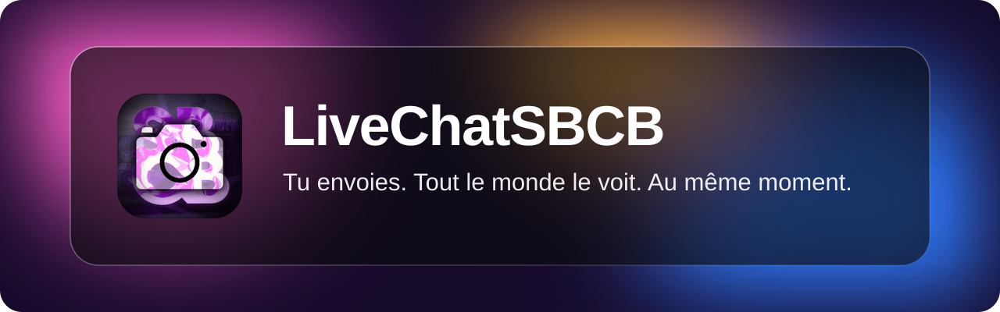
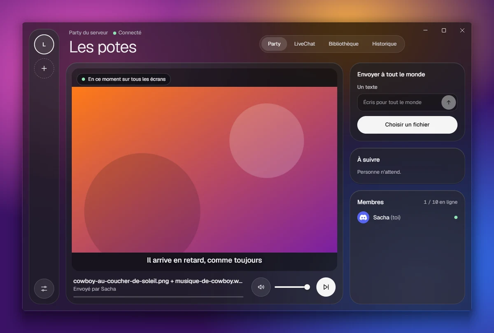
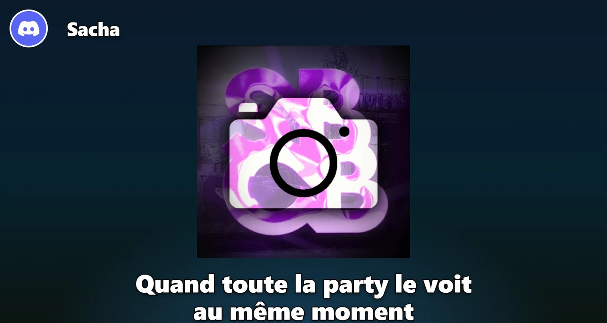
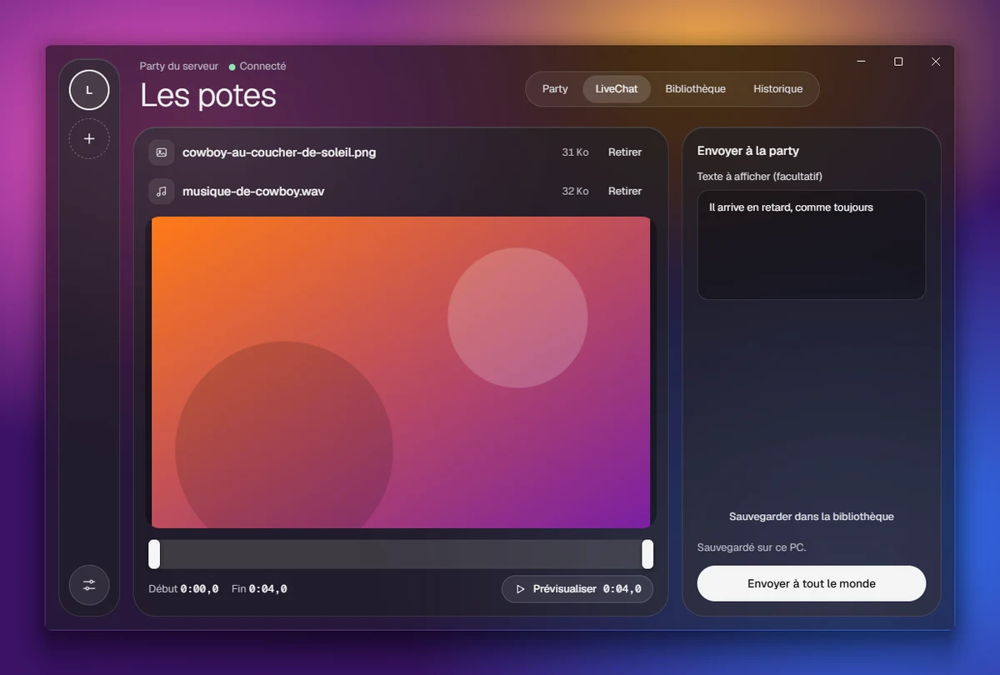
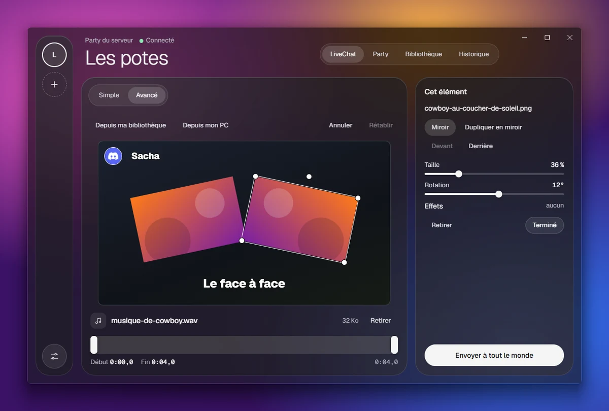
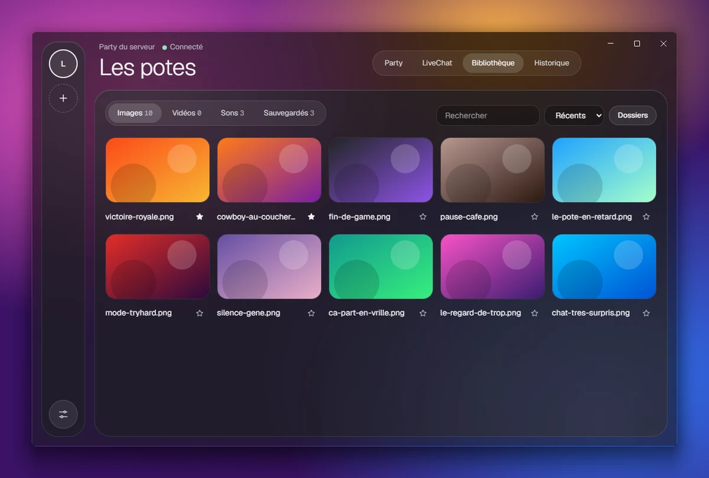
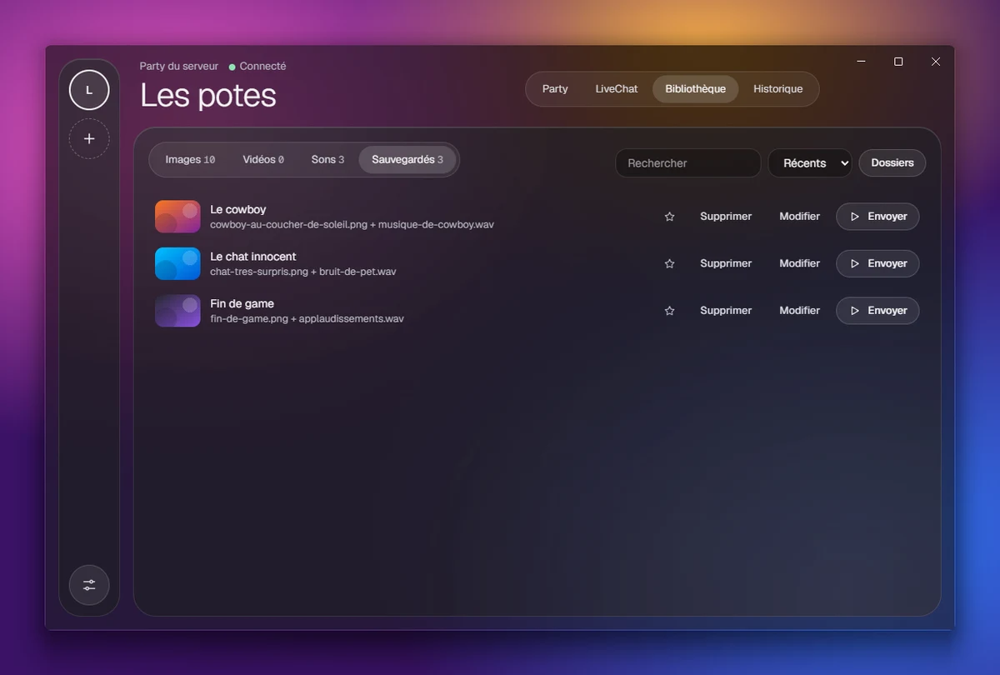
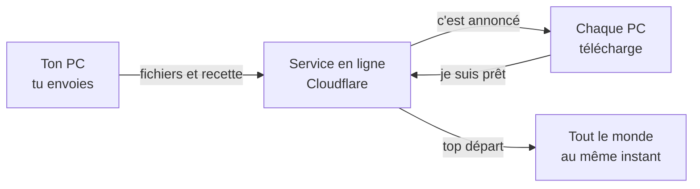

 

**L'app Windows et Mac pour faire rire tes potes, directement sur leur écran.**

Une image, une vidéo, un son ou un texte : tu l'envoies, et il s'affiche chez toute ta party en même temps, même en pleine partie.

 

  

  

 

## En 30 secondes

1. **Connecte-toi avec Discord.** L'app n'a jamais ton mot de passe.
2. **Choisis ton serveur.** Chaque serveur Discord a sa party, ouverte à ses membres qui ont l'app.
3. **Envoie quelque chose.** Une image avec un son, une vidéo, un texte.
4. **Tout le monde le voit en même temps,** par-dessus ce qu'il est en train de faire.

 

## Ce que voient tes potes

L'affichage se pose par-dessus le jeu, sans prendre le clavier ni la souris. Tes potes continuent de jouer, et les clics passent au travers. Quand rien ne passe, on ne voit rien.

 
Exemple sur un fond de démonstration. Chacun peut déplacer et redimensionner le pseudo, le média et le texte chez lui.

 

## Ce que tu peux faire

<table>
<tr>
<td width="50%" valign="top">

### Préparer un LiveChat

Une image ou une vidéo, un son, un texte sur plusieurs lignes, et ça part. Tu choisis le passage à jouer, et un petit écran te montre le rendu avec ton texte avant d'envoyer.

Avec une vidéo et un son, c'est toi qui décides ce qu'on entend : l'un, l'autre, ou les deux.

</td>
<td width="50%"></td>
</tr>
<tr>
<td width="50%" valign="top">

### Tout placer en mode avancé

Jusqu'à 5 images et une vidéo, posées où tu veux sur l'écran. Déplace, agrandis, tourne, mets en miroir à la souris, ajoute des effets et des animations, et regarde l'aperçu avec le son avant d'envoyer.

</td>
<td width="50%"></td>
</tr>
<tr>
<td width="50%" valign="top">

### Ranger ta bibliothèque

Montre tes dossiers, et l'app trie toute seule tes images, tes vidéos et tes sons. Recherche, tri, favoris épinglés en haut. Un clic droit sur un fichier permet de l'envoyer tout de suite, de le renommer ou de le retrouver dans l'Explorateur.

</td>
<td width="50%"></td>
</tr>
<tr>
<td width="50%" valign="top">

### Garder tes meilleurs

Donne un nom à un LiveChat réussi, et renvoie-le plus tard en un clic. Si un fichier a changé de place, l'app te le dit et t'aide à le retrouver.

</td>
<td width="50%"></td>
</tr>
</table>

**Et aussi :**

- **Une file d'attente :** les envois passent l'un après l'autre, sans se couper. Tout le monde peut passer au suivant.
- **Un historique :** rejoue un envoi pour tout le monde, ou revois-le juste pour toi. L'étoile garde un LiveChat marrant sur ton PC, pour le ressortir même des jours après.
- **Ton volume à toi :** chacun règle le son et peut couper le sien.
- **Envoi rapide :** Ctrl+V colle une image, une vidéo, un son ou un lien direct. Dans Windows, le clic droit sur un fichier propose « préparer » ou « envoyer direct ».
- **Emojis et voix robot :** des emojis façon Discord dans ton texte, et une case pour le faire lire à voix haute. Chacun peut couper la voix chez lui.
- **En plein jeu :** Shift+F1 à Shift+F10 envoient tes memes, Shift+F11 passe au suivant, sans quitter ton jeu.
- **Mode clean :** Shift+F12 coupe tout chez toi, son et image, jusqu'à ce que tu réappuies. La touche se change dans les réglages.
- **Ta tranquillité :** ignore un pote pour un moment, sans qu'il le sache, et coupe chez toi ce qui dure plus de 20 secondes.
- **Anti-spam :** le même LiveChat 5 fois en 1 minute, et plus aucun envoi pendant 30 minutes.
- **Une party privée :** avec un code à 6 caractères, sans passer par un serveur.
- **Discrète :** l'app reste près de l'horloge, ou dans la barre du haut sur Mac, et peut se lancer avec l'ordinateur. Une case dans les réglages le désactive.
- **Toujours à jour :** les mises à jour se font toutes seules.

 

## Installer

1. [Télécharge l'app](https://livechatsbcb-party.livechatsbcb-party.workers.dev/download) et lance-la. Le même lien marche sur Windows et sur Mac.
2. Windows peut afficher un avertissement, car l'app n'est pas signée : clique sur « Informations complémentaires », puis « Exécuter quand même ».
3. Sur Mac (puce Apple), [cette page](https://livechatsbcb-party.livechatsbcb-party.workers.dev/mac) explique comment l'ouvrir la première fois.
4. Connecte-toi avec Discord et choisis ton serveur. C'est tout.

 

## Bon à savoir

<b>Ça marche avec tous les jeux ?</b>

 
L'affichage passe par-dessus les jeux en mode <b>fenêtré sans bordure</b>. En plein écran exclusif, Windows ne le laisse pas passer : change ce réglage dans ton jeu. Sur Mac, les raccourcis sont Ctrl+Option+1 à 0.

<b>Qui peut m'envoyer quelque chose ?</b>

 
Tous ceux qui sont dans ta party : les membres du serveur qui ont l'app, ou ceux qui ont le code d'une party privée. <b>Il n'y a pas de modération.</b> Utilise l'app avec des gens en qui tu as confiance. Tu peux couper l'affichage à tout moment dans les réglages.

<b>Qu'est-ce que l'app voit de mon compte Discord ?</b>

 
Ton pseudo, ta photo et la liste de tes serveurs. Jamais ton mot de passe, ni tes messages. Il n'y a aucun bot à installer sur le serveur.

<b>Où vont mes fichiers ?</b>

 
Tes dossiers, tes favoris et tes LiveChats sauvegardés restent sur ton PC. Seul ce que tu envoies passe en ligne, et c'est effacé après 1 jour.

<b>Il y a des limites ?</b>

 
Oui, pour que le projet reste gratuit : 500 Mo par envoi, 10 personnes en ligne par party, et un stockage commun qui peut être plein un moment. Si c'est le cas, l'app le dit, et ça repart quand les anciens fichiers sont effacés.

<b>Pourquoi la fenêtre est transparente chez certains et pas chez d'autres ?</b>

 
L'effet de verre flouté, qui laisse voir ton bureau derrière la fenêtre, demande Windows 11 (version 22H2 ou plus récente). Ailleurs, le fond reste sombre, et tout le reste marche pareil.

 

## Bientôt

- [ ] **Liens :** YouTube et compagnie
- [ ] **OBS et synthèse vocale**

 

## Sous le capot

Personne ne reçoit de flux vidéo : chaque PC télécharge les fichiers à l'avance et les lance à la même heure, en corrigeant le décalage de son horloge.

- **App :** Electron, React, TypeScript
- **Service :** Cloudflare Workers, Durable Objects, R2
- **Connexion :** Discord (`identify` et `guilds`, sans bot)

Tu veux lancer le projet ou comprendre comment il est construit ? Tout est dans le [guide de développement](docs/DEVELOPPEMENT.md).

 

## Licence

LiveChatSBCB est sous licence [AGPL-3.0](LICENSE). Tu peux reprendre et modifier le code, à condition de partager tes changements sous la même licence, même si ta version tourne seulement en ligne.

Le nom et le logo ne sont pas concernés : ils restent à l'auteur du projet, et une version modifiée doit utiliser les siens. Détails dans [NOTICE](NOTICE).

 

Fait pour une bande de potes.

